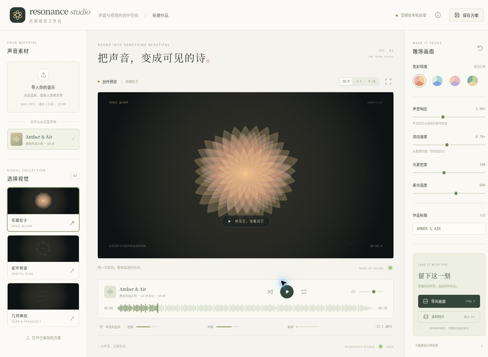

# Resonance Studio · 共振视觉工作台

把音乐变成可编辑、可导出的动态视觉作品。一个完全在浏览器内处理音频的音乐视觉工作台，包含原创合成示例、三种视觉主题、音频特征分析和创作方案保存。

**版本：v0.1.0 · 可运行的第一版**

[](https://github.com/Mecony/resonance-music-studio/actions/workflows/ci.yml)



## 先体验

下载本仓库的 ZIP（Code → Download ZIP）并解压，可以尝试用 Chrome 或 Edge 打开根目录的 **Resonance-Studio.html**。它把样式、脚本与分析 Worker 内嵌到单个文件中，无需安装 Python。当前环境仅完成该版本的脚本检查，尚未完成 file:// 浏览器实测；如浏览器限制本地 Worker，请使用下面经过验证的 HTTP 启动方式。

便携版由源码生成，重新生成命令：

```bash
python scripts/build-portable.py
```


## 已实现

- 原创示例曲 **Amber & Air**：程序合成的 38.4 秒音乐，可下载 WAV，无第三方音乐依赖。
- 本地音频导入：WAV 及浏览器可解码的 MP3 等格式，最大 32 MiB、最长 180 秒。
- Web Worker 预分析：短时 RMS、低/中/高频能量、正向频谱差分、64 个对数频率区间。
- 三种程序化主题：花瓣粒子、星环频谱、几何律动；四组配色。
- 播放、暂停、跳转、循环、音量；声音响应、运动速度、密度和柔光调整。
- 16:9 / 1:1 / 9:16 画布；PNG 原尺寸导出。
- 带音轨的实时短片录制，最长 30 秒；根据浏览器支持选用 WebM 或 MP4。
- JSON 方案导入/导出，校验版本、枚举、数值范围；方案不嵌入音频。

音频不会由应用上传到服务器；静态文件可自托管。页面没有外部字体、分析 SDK、运行时 CDN 或付费 API。

## 快速开始

无需安装 npm 依赖。需要 Python 3 启动静态服务器：

```bash
python -m http.server 8000 --directory dist
```

在浏览器打开 `http://localhost:8000`。Windows 可用 `py -m http.server 8000 --directory dist`；Linux/macOS 通常使用 `python3`。

请通过 HTTP 启动；直接双击 `index.html` 的 `file://` 模式无法正常加载模块 Worker。

1. 等待原创示例载入，点击播放。
2. 选择左侧主题和右侧配色，调整声音响应与元素密度。
3. 暂停或拖动时间轴，导出喜欢的画面。
4. 点击录制，保持页面前台运行，再点击停止；文件自动下载。
5. 保存方案。下次打开 JSON 后，如音频不同，按提示重新选择对应音频。

静音不会停止播放；导出视频也采用当前音量，因此录制前请确认音量不为零。

## 测试

需要 Node.js 22 或更新版本：

```bash
npm run check
npm test
```

测试覆盖 FFT 与直接 DFT 对照、已知正弦波 RMS、分频段能量、静音、时间插值、确定性合成、WAV 编码、方案校验，以及播放器暂停/跳转/循环/并发播放的生命周期。

参见 [验证记录](docs/VALIDATION.md) 和 [技术设计](docs/ARCHITECTURE.md)。CI 工作流会在 push 和 pull request 时运行；最新状态见上方徽章及 Actions 页面。本地验证结果与浏览器验证边界分别记录在验证文档中。

## 工程结构

```text
dist/index.html       页面与可访问控件
dist/styles.css       响应式工作台样式
dist/app.js           编辑器状态、导入、导出、UI 事件
dist/audio-engine.js  以 AudioContext 时钟驱动的播放器
dist/audio-worker.js  后台分析任务
dist/dsp.js           FFT、特征提取、原创音乐合成、WAV 编码
dist/visuals.js       三种确定性视觉渲染器
dist/settings.js      方案格式与输入校验
tests/                Node 内置测试，无测试库依赖
docs/                 算法、验证与使用边界
```

采用原生 JavaScript ES Modules、Canvas 2D、Web Audio API、Web Worker 和 Node 内置测试。第一版使用无构建部署，便于阅读、离线运行和托管到 GitHub Pages；未使用 React，也未训练机器学习模型。

## 部署到 GitHub Pages

这是纯静态项目。可以将 `dist/` 的内容放到 Pages 发布目录，也可以通过自己的 Pages 构建工作流发布 `dist/`。启用 GitHub Pages 由仓库管理员在仓库设置中完成；本项目没有自动修改仓库发布设置。

## 使用边界

- 突变强度是正向频谱差分，不是完整 BPM/节拍检测，更不代表情绪识别。
- 播放使用原声道；分析对声道求平均，反相立体声可能相消，影响视觉响应。
- 每次载入会解码整段文件；第一版限制时长和大小，不处理流式长音频。
- 录制是实时捕获。目标采样 30 fps，但实际帧率依赖设备、浏览器与页面前台状态；目前未保证恒定帧率或离线导出。
- 云端浏览器验证了录制生成的音视频轨道，但观察到低帧率，尚需在个人电脑进行流畅度与音画同步验收。
- 预计算平滑与固定随机种子让视觉状态独立于播放历史；不同浏览器的字体、Canvas 抗锯齿可能不同，不承诺跨浏览器像素一致。
- 手机布局提供了适配 CSS，尚未进行真机兼容性验收。

## 后续候选

1. 录制帧率诊断及确定性离线视频导出。
2. 独立节拍估计及效果评估。
3. 关键帧、背景素材、更多视觉渲染器。

## 授权

代码及原创示例音乐采用 [MIT License](LICENSE)。导入素材的使用权由素材持有人决定。
